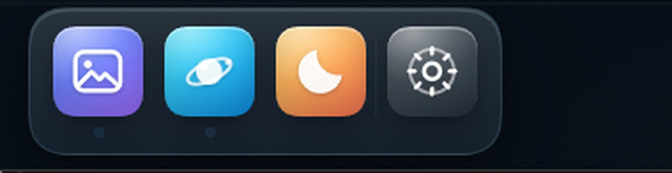

# 功能坞 · dsh-feature-dock

苹果 macOS Dock 风格的底部导航条，装在 DSH Web GUI 里。鼠标扫过时图标按弹簧曲线放大、左右让位，底部玻璃条跟着变宽；松手离场又平滑缩回。



## 现在有什么

| 图标 | 功能 | 交互 |
|---|---|---|
| 🖼 壁纸（蓝紫） | 显示 / 隐藏壁纸引擎的壁纸层、暗化层和拉绳吉祥物 | 点击开关，不修改壁纸插件自己的设置 |
| 🔮 悬浮球（青色） | 开 / 关原生悬浮球 | 点击开关，读取 / 写入 `dsh-orb` 的 `/.dsh-orb` 路由 |
| ☀/🌙 主题（橙） | 深色 / 浅色主题切换 | 点击切换 |
| ⚙ 设置（玻璃灰） | 打开功能坞设置 | 调整图标大小、放大强度、放大范围；恢复默认 |

- 图标下方的小圆点 = 开关状态（亮 = 开）；悬浮球插件没运行时圆点变暗、图标去饱和。
- 悬停时图标上方浮出名字 + 状态胶囊，位置跟着被放大的图标走。
- 交互全部走 `pointer` 事件，触屏轻点也能用；尊重系统「减少动态效果」设置（关闭放大动画，只保留开关和标签）。
- 设置存在浏览器 localStorage（`dsh-feature-dock:prefs:v1`），壁纸开关状态存在 `dsh-feature-dock:wallpaper:v1`。

## 形态说明

当前是**真实形态**：坞里只有 3 个真实开关（壁纸 / 悬浮球 / 主题）+ 设置，共 4 个图标，按注册表顺序排列（壁纸 → 悬浮球 → 主题 → 设置）。

演示用的 12 个假图标保留在 `DEMO_FEATURES` 里，默认不启用。想临时做演示时，把：

```js
const FEATURES = REAL_FEATURES;
```

改成：

```js
const FEATURES = REAL_FEATURES.concat(DEMO_FEATURES).sort((a, b) => a.hue - b.hue);
```

就会回到 16 个图标、按色相排成彩虹的样子；演示状态存在 `dsh-feature-dock:demo:v1`，不污染真实开关。

## 实现位置

- 布局占位：`shell.bottom`（全宽底栏，高 64px，只放一个透明占位）。
- 可见的坞：`shell.overlay`（帧级浮层），固定贴在窗口底部，所以图标放大时可以越出底栏、不会被裁切。
- 壁纸开关：给 `<html>` 打 `data-dfd-wallpaper="off"`，用本插件作用域内的样式把 `.we-layer` / `.we-scrim` / `.we-rope` 平滑淡出；不改壁纸插件的任何设置，重新打开立即恢复。
- 悬浮球：`GET /.dsh-orb/settings` 读状态，`POST /.dsh-orb/ball {enabled}` 开关，4 秒轮询一次。
- 主题：读 / 写 DSH 的 `theme` 服务。
- 放大：rAF 弹簧（临界阻尼）驱动 `transform: translate3d + scale`，React 不为每一帧重渲染；每帧按所有图标的**视觉边界**重新算玻璃条宽度并居中（两端始终留 13px），高度随最高图标向上长，所以放大时图标不会顶出玻璃。

## 以后加新功能

在 `client.js` 里：

1. 写一个 24×24 的 `viewBox` 图标函数（用 `currentColor`，白色描边即可）。
2. 往 `FEATURES` 数组里加一项：

```js
{
  id: 'my-feature',           // 唯一 id
  tint: 'wall',               // wall | orb | theme | gear，或自己加一段 .dfd-tile[data-tint=...] 渐变
  accent: '#9db4ff',          // 小圆点颜色
  icon: MyIcon,               // 图标组件
  nameKey: 'name.myFeature',  // 中文/英文词典里的名字
  hintKey: 'hint.myFeature',
}
```

真实形态按数组顺序排列；只有启用演示项时才需要 `hue` 字段和 `.sort((a, b) => a.hue - b.hue)`。

3. 在 `featureStateOf()` 里给它一个状态（`on` / `off` / `busy` / `na`）。
4. 在 `activate()` 里接上动作（调用 store 的方法，或直接 fetch 你自己的接口）。
5. 在 `zh` / `en` 词典里补两条文案。

新增设置项的话：在 `PREF_SPEC` 加范围、在设置面板加一行 slider 即可。

## 安装 / 卸载

- 安装：解压后把 `dsh-feature-dock` 目录放到任意位置，在 DSH 的 `plugin_manager` 里执行 `install_bundle`，target 指向这个目录的绝对路径；装好后刷新页面（Ctrl+R），坞会出现在 DSH 窗口底部。
- 依赖：壁纸开关需要 `dsh-plugin-wallpaper-engine`，悬浮球开关需要 `dsh-orb`；没装时对应项显示「未运行」，其余功能不受影响。
- 卸载：`plugin_manager` 的 `remove_bundle`，target 用包名 `dsh-feature-dock`。
- 改完 `client.js` 后按 `Ctrl+R` 重载页面；开关状态与设置都存在 localStorage / 宿主文件里，不会丢。

## 已知边界

- 壁纸开关是**显示开关**：给 `<html>` 打 `data-dfd-wallpaper="off"`，淡出 `.we-layer` / `.we-scrim` 并把拉绳吉祥物 `.we-rope` 设为 `visibility:hidden`（淡出 0.45s 后从命中测试与无障碍树里退场）。壁纸插件自己的播放、轮播、设置都继续运行，重新打开零损失。
- 壁纸类名来自 `dsh-plugin-wallpaper-engine` 1.3.0（`.we-layer` / `.we-scrim` / `.we-rope`）。它大版本升级改了类名时，只需要改 `STYLES` 里那三条选择器。
- 悬浮球开关依赖 `dsh-orb` 的 HTTP 路由；没装 / 宿主未启动时该项显示「未运行」，不会报错。
- 坞贴在窗口底部居中；窗口本身被拖到屏幕边缘之外时，坞会跟着被裁掉（那是窗口位置，不是坞的问题）。
